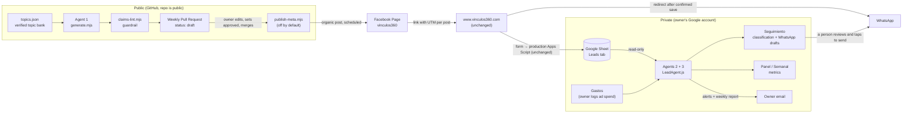

# Vínculos 360 — Autonomous lead generation system

Low-cost automation to reach the first **10 qualified leads in 30 days** for residential electricity in Texas.
It adds **no new paid services** and does **not** change the website, the production Apps Script, or the `Leads` sheet.

| Agent | What it does | Where it runs | When |
| --- | --- | --- | --- |
| **1. Content & organic growth** | Builds next week's Spanish-first Facebook posts (English version included) from a bank of verified topics, checks every post for unsupported claims, opens a Pull Request for review, and schedules **approved** posts on the Facebook Page (only if enabled). | GitHub Actions (`.github/workflows/agentes-marketing.yml`) | Thursdays 13:23 UTC (drafts) · on merge (scheduling) |
| **2. Lead management** | Reads `Leads` (read-only), detects duplicates and test rows, classifies each lead, prepares a WhatsApp follow-up **draft** with a click-to-open link, tracks follow-up status, and emails the owner when leads arrive. | Separate Google Apps Script project in the owner's Google account (`automation/apps-script/LeadAgent.js`) | Every 15 minutes |
| **3. Analytics & optimization** | Computes valid, qualified and per-source/per-post leads, spend, cost per lead and cost per qualified lead, budget alerts at 80 % / 100 % of the $50 cap, and a weekly report with data-based recommendations. | Same Apps Script project | Every 15 minutes (Panel) · Mondays 8 a.m. (email) |
| **4. Opportunity discovery** | Scores public signals (0–100, A/B/C), dedupes, adds new Houston-area real estate agents from TREC open data (Trade), drafts replies with attributed analyzer links, links opportunities to leads by `utm_content`, writes the **Embudo** dashboard and emails a daily brief. See `docs/OPPORTUNITIES.md`. | Same Apps Script project (`automation/apps-script/OpportunityAgent.js`) | Daily 6 a.m. (discovery) · 7 a.m. (brief) |

Customer data never leaves the owner's Google account: Agents 2 and 3 run there, and nothing with personal data is stored in this public repository or in GitHub Actions logs.

## Architecture



Why this design: GitHub Actions is free for public repositories and already used for deploys; Apps Script is free, already holds the lead data, and keeps personal information private. Azure Functions or Logic Apps were evaluated and rejected: they add a billable resource and would require copying lead data out of Google. Claude scheduled tasks are an optional add-on for topic research (see below), not a dependency.

## Schedule

| When (Texas time) | What | Owner action |
| --- | --- | --- |
| Every 15 min | Agent 2 adds new leads to **Seguimiento**, emails the owner if any are actionable; Agent 3 refreshes **Panel** and checks the budget | Reply to new leads from the WhatsApp link; update **Estado** |
| Monday 8 a.m. | Weekly report email + row in **Semanal** | Read recommendations |
| Thursday ~7–8 a.m. | Agent 1 opens a PR with next week's 3 posts (Mon 7 p.m., Wed 12:30 p.m., Fri 7 p.m.) | Review, set `status: "approved"`, merge |
| On merge | Approved posts are scheduled on Facebook (or simulated if disabled) | — |
| Whenever you spend on ads | — | Add a row to **Gastos** |

## Current installation (Nov 22, 2026)

The site form now posts to **Vínculos 360 — Receptor de leads** (`automation/apps-script/receptor/Receptor.js`), an Apps Script web app in the owner's Google account. It writes to the `Leads` tab of the sheet **Vínculos 360 — Leads**. Agents 2 and 3 are installed as the Apps Script project **Vinculos 365** against that sheet, with both triggers active. The steps below describe how to reinstall either one.

## Setup (owner steps)

### A. Lead management and analytics (Google) — ~10 minutes

1. Open <https://script.google.com> with the Google account that owns the Leads spreadsheet → **New project**. Name it `Vínculos 360 — Agente de leads`. This is a **new, separate** project; do not edit the script that receives the form.
2. Replace `Code.gs` with the contents of `automation/apps-script/LeadAgent.js`.
3. **Project Settings** → check *Show "appsscript.json"* → paste `automation/apps-script/appsscript.json`. Set the time zone to `America/Chicago` if asked.
4. **Project Settings → Script properties**: add `SPREADSHEET_ID` (the long ID in the Sheet's URL). Optional: `OWNER_EMAIL`, `GOAL_START` (e.g. `2026-11-30`), `GOAL_QUALIFIED` (10), `GOAL_DAYS` (30), `BUDGET_CAP_USD` (50), `ALERT_DETAILS` (`true` to include first name and service in alerts; phone numbers are never emailed).
5. Run `runSelfTest` once (no sheet access, mock data) and check the log.
6. Run `setup` once and accept the permissions. It validates the `Leads` columns, creates the **Seguimiento, Panel, Semanal, Gastos, Registro** tabs and the two triggers. Running it again does not duplicate anything.
7. Delete the old "PRUEBA QA" rows from Leads if you like; the agent already excludes test rows.

The agent finds columns by header name (`Timestamp/Fecha`, `Name/Nombre`, `Phone/Teléfono`, `ZipCode/ZIP`, `Service/Servicio`, `Source`, `Medium`, `Campaign`, `Ad`, …). If required columns are missing, `setup` stops with a clear message instead of guessing.

**Seguimiento columns the owner edits:** `Estado` (dropdown: Nuevo, Contactado, Calificado, No calificado, Cliente, Sin respuesta, No contactar), `Próximo paso`, `Notas`. A lead counts as **qualified** only when a person sets it to *Calificado* or *Cliente*.

### B. Content agent (GitHub) — ~2 minutes

1. Repository **Settings → Actions → General → Workflow permissions**: enable *Allow GitHub Actions to create and approve pull requests*. Without it the weekly PR cannot be opened (the run will open an alert issue saying so).
2. Optional: run it now from **Actions → Agentes de marketing → Run workflow → generar-borradores**.

### C. Automatic Facebook scheduling (optional, needs your authorization)

Until this is done, merged posts are only *simulated*; you can copy the **Publicar** section into Facebook by hand.

1. In Meta for Developers, create an app with the **Pages API** and get a long-lived **Page access token** with `pages_manage_posts` for the Vínculos 360 page.
2. Repository **Settings → Environments → `facebook`** (created on first run, or create it): add secrets `META_PAGE_ID` and `META_PAGE_TOKEN`. Optionally add yourself as a *required reviewer* so every scheduling run waits for your click.
3. **Settings → Variables → Actions**: add `META_PUBLISH_ENABLED` = `true`.

The publisher only creates organic posts (`POST /{page-id}/feed`, `published=false` + scheduled time). It contains no ads or boosting code, so it cannot spend money.

### D. Optional: AI topic research with a Claude scheduled task

The topic bank (`automation/content/topics.json`) has 12 verified topics, enough for 4 weeks without repeats. To keep it growing, a weekly Claude scheduled task can research new topics and open a PR that adds them (sources required, same guardrail). It uses your existing Claude plan; no API keys. Ask Claude to create it after this PR is merged, using `automation/content/RESEARCH_PROMPT.md`.

## Guardrails built in

- **Claims check** (`claims-lint.mjs`) blocks: savings with figures, prices, percentages, guarantees/superlatives, "gratis/free", credential claims, testimonials, and provider names (including the security provider, which must never appear publicly). Facts in `automation/config/business.json` unlock a rule only when marked `verified: true` by the owner.
- **Every post cites official sources** (PUCT, ERCOT) and carries a unique UTM (`utm_content` = topic id), so Agent 3 can attribute leads to posts.
- **No unsolicited messages:** Agent 2 only writes drafts. Every draft includes an opt-out line. A person opens the `wa.me` link and sends it.
- **No duplicate posts:** a post is scheduled only the first time it becomes `approved`; edits later are ignored. If Meta doesn't answer in time, the run reports *unverified* instead of retrying.
- **No fabricated analytics:** missing spend → "sin datos"; website visits → "not available" (no web analytics installed).
- **Spend:** no component can buy ads. The $50 cap is monitored from the **Gastos** tab with alerts at 80 % and 100 %.

## Operating cost estimate

| Item | Monthly cost |
| --- | --- |
| GitHub Actions (public repo, ~10 short runs/month) | $0 |
| Google Apps Script (consumer quota: 90 min/day of trigger runtime; this uses roughly 5–15 min/day) | $0 |
| Gmail alerts (consumer quota: 100 recipients/day; this sends a few per day) | $0 |
| Meta Pages API (organic posts) | $0 |
| Azure Static Web Apps | unchanged (no new resources) |
| Claude scheduled research task (optional) | included in your existing Claude plan |
| **Paid ads** | **$0 until you approve; cap $50** |

Setup time: about 15 minutes of owner time (steps A and B), plus Meta app setup if you want automatic scheduling.

## Security and compliance checklist

- [x] No credentials or customer data in the repository; Meta token only as an environment secret; Apps Script settings in Script Properties.
- [x] Lead data stays in the owner's Google account; GitHub logs contain no personal data; alert issues contain no personal data.
- [x] Production Apps Script and `Leads` tab untouched (read-only access, verified by tests).
- [x] Spreadsheet formula injection neutralized in values copied from the form.
- [x] Alert emails exclude phone numbers; names only if `ALERT_DETAILS=true`.
- [x] No automated outbound messaging to customers; drafts include an opt-out.
- [x] No paid services or ad spend; budget cap monitoring only.
- [x] Development branch + Pull Request; production deploy workflow only gained `paths-ignore: marketing/**`.
- [ ] **Owner/legal:** confirm whether Vínculos 360's electricity activity requires **PUCT broker registration** (Texas requires anyone providing brokerage services to register).
- [ ] **Owner/legal:** follow-up by text/WhatsApp should stay a reply to the customer's own request. Texas SB 140 (effective Sept 1, 2025) brought text messages under the state telephone-solicitation law; get legal advice before any proactive or bulk texting.
- [ ] **Owner/legal:** add a privacy notice and contact consent text to the form (still open from the site audit).
- [ ] **Owner:** confirm the facts in `automation/config/business.json` before any post mentions providers, cost to the customer, or registration.

## Tests

```bash
node --test tests/*.test.js              # all tests (no dependencies needed for the agents)
node automation/content/claims-lint.mjs  # checks every post in marketing/posts
node automation/content/generate.mjs --dry-run --week-start 2026-12-07
node automation/apps-script/demo-report.mjs   # writes automation/out/panel-demo.html with mock data
```

The suite runs the real `LeadAgent.js` against a simulated Google Sheet, including failure scenarios: transient Sheets errors (retried), persistent failure (logged + one owner alert per 6 h), missing spreadsheet or configuration, concurrent runs (lock), missing columns, Meta 5xx (retried), Meta 403 (not retried), Meta timeout (not retried, marked unverified), late or already-approved posts (not scheduled), and budget thresholds.

## Rollback

Nothing here touches the live site, so rollback never requires a site redeploy.

| Component | How to turn it off | Effect |
| --- | --- | --- |
| Facebook scheduling | Set `META_PUBLISH_ENABLED` to `false` (or delete it). Delete already-scheduled posts in Meta Business Suite → Planner. | Merges become simulations only. |
| Weekly drafts | **Actions → Agentes de marketing → ⋯ → Disable workflow** | No more PRs. |
| Lead + analytics agent | In the Apps Script project: **Triggers** → delete both (or delete the project). Optionally delete the added tabs. | Leads keep arriving in `Leads` exactly as before. |
| All code | `git revert -m 1 <merge-commit>` on `main` | Repository returns to the `4ffcfea` state (verified: reverting this branch's commits yields a tree identical to `4ffcfea`). |
